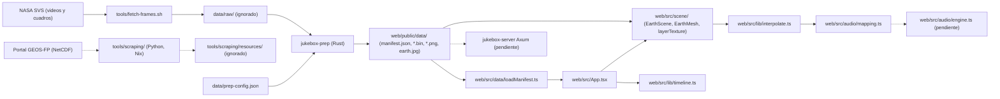
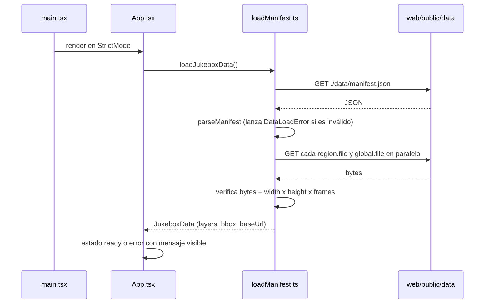
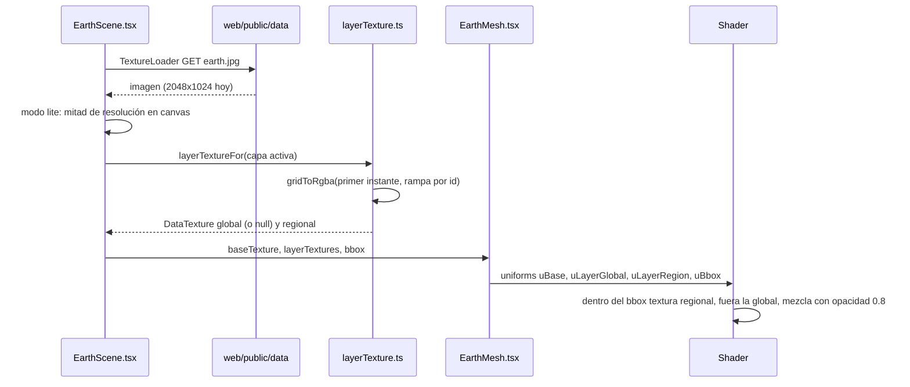
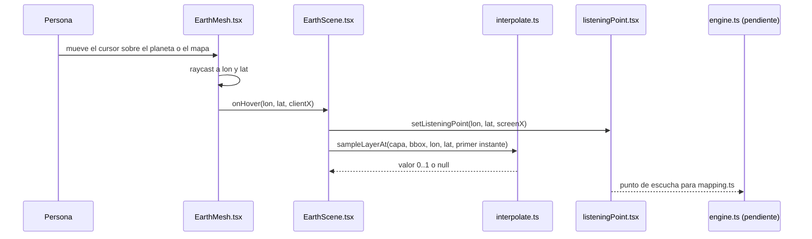
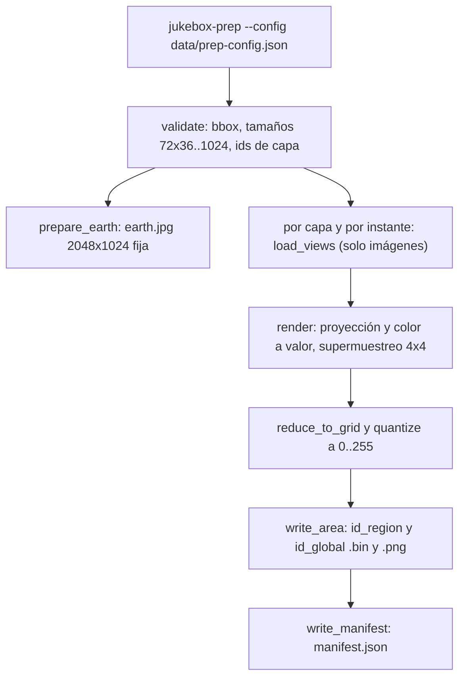

# Architecture

## Architecture Analysis

### System Overview

Aplicación local de una sola página. Un proceso por lotes en Rust (`jukebox-prep`) convierte cuadros de visualizaciones NASA en datos estáticos preparados (`web/public/data/`); la interfaz React los descarga una vez al iniciar, los interpola en el navegador, los dibuja sobre un planeta 3D (`web/src/scene/`) y traduce valores a parámetros de sonido. No hay base de datos ni backend con lógica: el único servidor previsto (`jukebox-server`, Axum) solo entregará archivos estáticos en `127.0.0.1`. Unos scripts Python de exploración (`tools/scraping/`) descargan NetCDF de GEOS-FP, pero no alimentan a prep.

### Architectural Style

Monolito cliente con preparación de datos fuera de línea (patrón "static data pipeline + thick client"). Evidencia: `vite.config.ts` con `base: "./"` y sin proxy; `loadJukeboxData()` usa `fetch` relativo a `./data/`; `server/Cargo.toml` solo declara `tower-http` con `fs`. Todo se ejecuta en contenedores Docker (`docker-compose.yml`), salvo `tools/fetch-frames.sh` (anfitrión con `curl` y `ffmpeg`) y `tools/scraping/` (entorno Nix).

### Component Relationships

<!-- Texto alternativo: NASA SVS alimenta tools/fetch-frames.sh, que escribe data/raw/. Los scripts de tools/scraping/ (línea punteada) descargan NetCDF de GEOS-FP a tools/scraping/resources/ y no se conectan con prep. jukebox-prep lee data/raw/ y data/prep-config.json y escribe web/public/data/. loadManifest.ts carga esos datos para App.tsx, que monta la escena de web/src/scene/; la escena también pide earth.jpg directamente, consulta interpolate.ts para el valor bajo el cursor, y ese valor alimenta mapping.ts. Pendientes: engine.ts y jukebox-server. -->

### Data Flow

1. **Fuera de línea**: `fetch-frames.sh` descarga cuadros y extrae fotogramas con `ffmpeg`; `jukebox-prep` abre cada cuadro como imagen raster (`image::open`, `pipeline.rs:66`), proyecta cada celda (`equirect` u `orthographic`, `project.rs`), convierte color → valor (`colorbar`, `brightness`, `warmth`), promedia con supermuestreo 4×4 (`SUPERSAMPLE`, `pipeline.rs:18`), cuantiza a 0..255 y escribe `<id>_<global|region>.bin/.png` y `manifest.json`. La imagen base se redimensiona siempre a `earth.jpg` 2048×1024 (`EARTH_TEXTURE`, `pipeline.rs:21`).
2. **Al iniciar**: `loadJukeboxData("./data/")` valida el manifiesto y descarga todas las cuadrículas en paralelo, comprobando que cada archivo tenga `width*height*frames` bytes.
3. **Dibujo**: `EarthScene` carga `earth.jpg` con `TextureLoader` (mitad de resolución en modo lite) y `layerTextureFor` crea `DataTexture` RGBA desde las cuadrículas (primer instante, rampa de color por id). `EarthMesh` mezcla en el shader la imagen base y la capa: dentro del `bbox` usa la textura regional, fuera la global si existe.
4. **En interacción**: lon/lat (raycast en esfera o plano) → `sampleLayerAt()` (bilineal en espacio, lineal en tiempo; cuadrícula regional dentro de `bbox`, global fuera, `null` si no hay) → valor en pantalla y punto de escucha → funciones de `mapping.ts`.

Formato de cuadrícula: un byte por celda, ordenado por instante, luego fila (norte primero), luego columna (oeste primero). Detalle del contrato en `api-documentation.md`.

### Key Design Decisions

- **Datos preparados y estáticos** en lugar de leer los cuadros NASA en vivo: arranque sin internet y carga pequeña (unos 1.3 MB hoy). Costo: los valores son aproximados y dependen de una georreferenciación manual.
- **Entrada solo por imagen**: prep lee PNG/JPEG/TIFF/EXR con el crate `image` y no tiene lector NetCDF ni de video. Una fuente NetCDF (GEOS-CF) necesita un nuevo tipo de entrada en prep o un paso externo que la convierta en imagen equirectangular.
- **Tamaños de cuadrícula configurables con límites fijos**: `grid.global` y `grid.region` en `data/prep-config.json`, mínimos 72×36 y 32×32 (`grid.rs:6-7`), máximo 1024 por lado (`config.rs:78`). Las texturas PNG de prep tienen tamaños fijos (global 1024×512, región 512 de ancho) y la escena no las usa.
- **Contrato de datos duplicado** Rust (`config.rs`, escribe) / TypeScript (`types.ts`, valida al leer) con conjunto cerrado de ids de capa (`LAYER_IDS`). Da errores claros, pero cualquier capa nueva exige cambiar ambos lados.
- **Texturas de capa dibujadas en el cliente desde las cuadrículas** (`layerTexture.ts`): la escena acepta cualquier tamaño de cuadrícula y cualquier id (rampa neutra para ids desconocidos). Solo el primer instante se dibuja.
- **Una sola imagen base equirectangular** para esfera y mapa (`uBase` muestreada con `vUv`, `EarthMesh.tsx:102`); no hay ranura para un recorte regional de alta resolución.
- **Lógica pura separada de la Web Audio API** (`mapping.ts`) y de la escena, para probarla en Vitest con entorno `node`.
- **Docker como único requisito** para la app y prep (Node y Rust dentro de contenedores; puerto publicado solo en `127.0.0.1`); las herramientas de descarga son la excepción.

### Improvement Opportunities

- Generar los tipos TS desde el esquema Rust (o un JSON Schema compartido) para no duplicar `LAYER_IDS` y la forma del manifiesto.
- Añadir a prep una entrada de malla regular (NetCDF o binario crudo) con remuestreo explícito de 721 filas centradas en los polos a 720 celdas centradas.
- Hacer configurable el tamaño de `earth.jpg` y su calidad, y añadir una imagen base regional opcional al manifiesto y al shader.
- Dibujar las texturas de capas con tiempo desde las cuadrículas en cada instante (hoy solo `FIRST_INSTANT`).
- Definir una frontera explícita entre escena 3D y motor de sonido mediante el punto de escucha compartido (`listeningPoint.tsx` ya existe).

## Interaction Diagrams

### Carga de datos al iniciar

<!-- Texto alternativo: main.tsx monta App; App llama a loadJukeboxData, que pide manifest.json, lo valida con parseManifest, pide en paralelo cada archivo de cuadrícula, comprueba su tamaño y devuelve JukeboxData. App pasa al estado ready o muestra el error. -->

### Dibujo del planeta con la capa activa

<!-- Texto alternativo: EarthScene carga earth.jpg con TextureLoader (en modo lite la reduce a la mitad), pide a layerTexture las texturas de la capa activa, que convierte el primer instante de cada cuadrícula a RGBA con la rampa de su id, y pasa todo a EarthMesh, que lo entrega al shader: dentro del bbox de la Amazonía usa la textura regional, fuera la global, y la mezcla sobre la imagen base con opacidad 0.8. -->

### Punto bajo el cursor → sonido

<!-- Texto alternativo: la persona mueve el cursor; EarthMesh convierte el punto a lon/lat con un raycast y avisa a EarthScene, que publica el punto de escucha (lon, lat, posición horizontal) y pide el valor con sampleLayerAt para mostrarlo. El motor de sonido pendiente leerá el punto de escucha y usará mapping.ts. -->

### Preparación de datos

<!-- Texto alternativo: jukebox-prep valida la configuración (bbox, tamaños entre los mínimos y 1024 por lado, ids de capa), redimensiona la imagen del planeta a earth.jpg de 2048x1024, y por cada capa e instante carga las vistas como imágenes, las proyecta y convierte color en valor con supermuestreo, reduce y cuantiza la cuadrícula, escribe los archivos bin y png de región y global, y al final escribe manifest.json. -->
