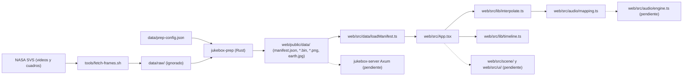
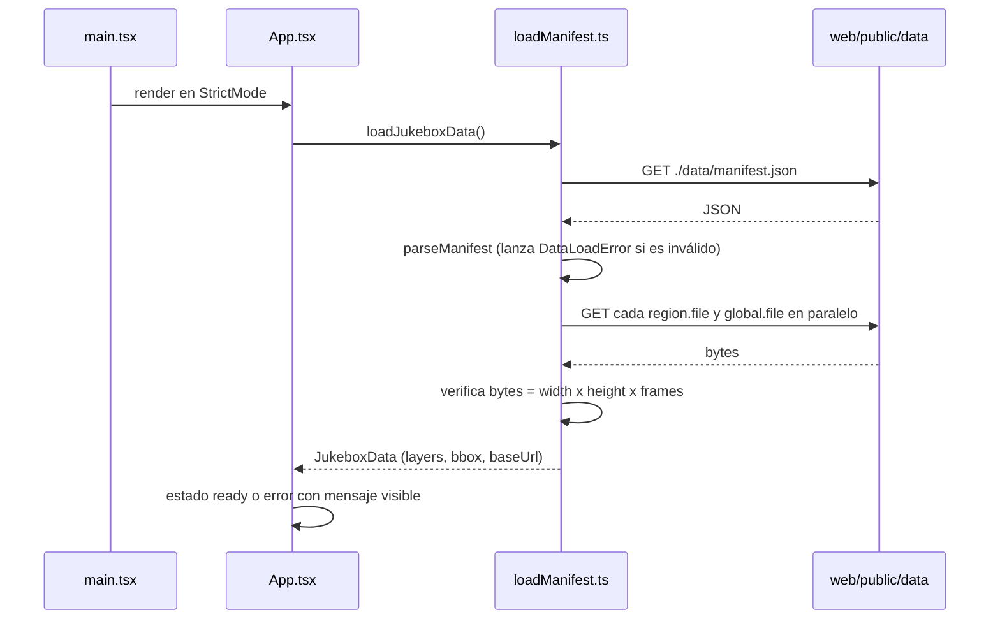
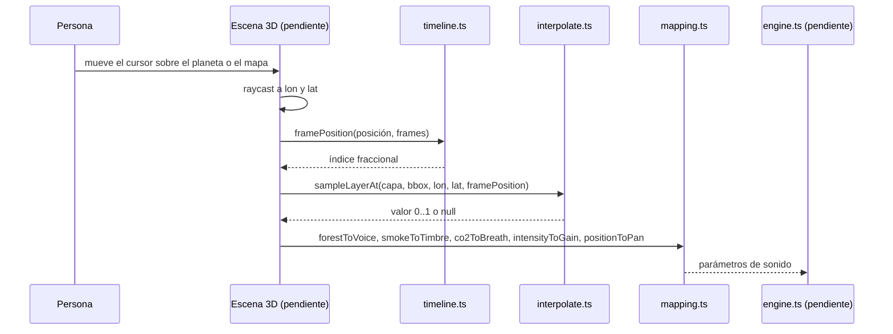
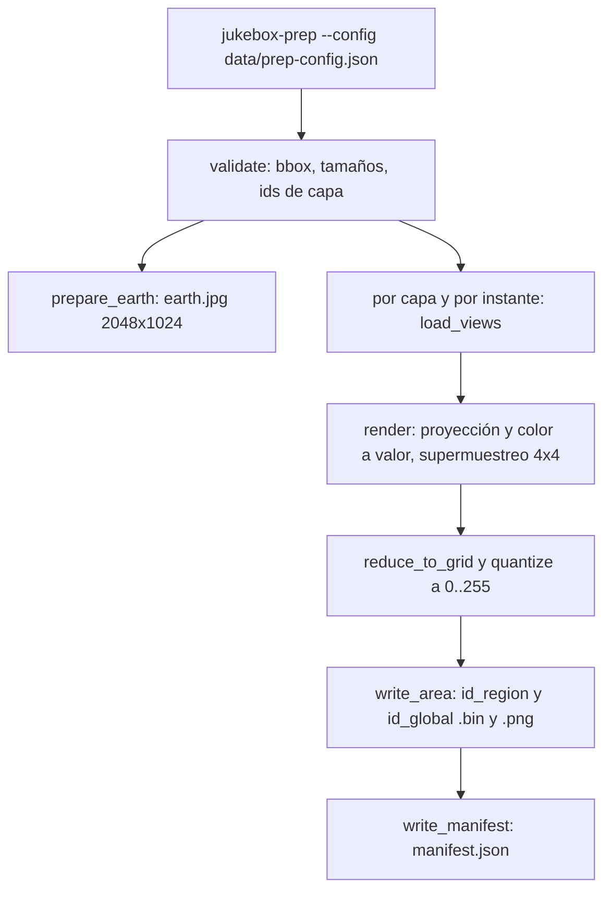

# Architecture

## Architecture Analysis

### System Overview

Aplicación local de una sola página. Un proceso por lotes en Rust (`jukebox-prep`) convierte cuadros de visualizaciones NASA en datos estáticos preparados (`web/public/data/`); la interfaz React los descarga una vez al iniciar, los interpola en el navegador y traduce valores a parámetros de sonido. No hay base de datos ni backend con lógica: el único servidor previsto (`jukebox-server`, Axum) solo entregará archivos estáticos en `127.0.0.1`.

### Architectural Style

Monolito cliente con preparación de datos fuera de línea (patrón "static data pipeline + thick client"). Evidencia: `vite.config.ts` con `base: "./"` y sin proxy; `loadJukeboxData()` usa `fetch` relativo a `./data/`; `server/Cargo.toml` solo declara `tower-http` con `fs`. Todo se ejecuta en contenedores Docker (`docker-compose.yml`).

### Component Relationships

<!-- Texto alternativo: NASA SVS alimenta tools/fetch-frames.sh, que escribe data/raw/. jukebox-prep lee data/raw/ y data/prep-config.json y escribe web/public/data/. loadManifest.ts carga esos datos para App.tsx, que usa interpolate.ts y timeline.ts; interpolate.ts alimenta mapping.ts. Pendientes (líneas punteadas): engine.ts recibe los parámetros de mapping.ts, scene/ y ui/ cuelgan de App.tsx, y jukebox-server servirá los datos y la app compilada. -->

### Data Flow

1. **Fuera de línea**: `fetch-frames.sh` descarga cuadros y extrae fotogramas con `ffmpeg`; `jukebox-prep` proyecta cada celda (equirectangular u ortográfica), convierte color → valor (`colorbar`, `brightness`, `warmth`), promedia con supermuestreo 4x4, cuantiza a 0..255 y escribe `<id>_<global|region>.bin/.png` y `manifest.json`.
2. **Al iniciar**: `loadJukeboxData("./data/")` valida el manifiesto y descarga todas las cuadrículas en paralelo, comprobando que cada archivo tenga `width*height*frames` bytes.
3. **En interacción**: lon/lat + posición de línea de tiempo → `framePosition()` → `sampleLayerAt()` (bilineal en espacio, lineal en tiempo; cuadrícula regional dentro de `bbox`, global fuera, `null` si no hay) → funciones de `mapping.ts` → parámetros de audio.

Formato de cuadrícula: un byte por celda, ordenado por instante, luego fila (norte primero), luego columna (oeste primero). Detalle del contrato en `api-documentation.md`.

### Key Design Decisions

- **Datos preparados y estáticos** en lugar de leer los cuadros NASA en vivo: arranque sin internet y carga pequeña (1.2 MB). Costo: los valores son aproximados y dependen de una georreferenciación manual.
- **Contrato de datos duplicado** Rust (`config.rs`, escribe) / TypeScript (`types.ts`, valida al leer) con conjunto cerrado de ids de capa. Da errores claros, pero cualquier capa nueva exige cambiar ambos lados.
- **Lógica pura separada de la Web Audio API** (`mapping.ts`) y de la escena, para probarla en Vitest con entorno `node`.
- **Docker como único requisito** (Node y Rust dentro de contenedores; puerto publicado solo en `127.0.0.1`).

### Improvement Opportunities

- Generar los tipos TS desde el esquema Rust (o un JSON Schema compartido) para no duplicar `LAYER_IDS` y la forma del manifiesto.
- Dibujar las texturas de capas con tiempo desde las cuadrículas en el cliente (las PNG son solo del primer instante).
- Definir una frontera explícita entre escena 3D (pasos 12-14) y motor de sonido (paso 10), por ejemplo un estado compartido "punto escuchado" con lon/lat y posición horizontal en pantalla.

## Interaction Diagrams

### Carga de datos al iniciar

<!-- Texto alternativo: main.tsx monta App; App llama a loadJukeboxData, que pide manifest.json, lo valida con parseManifest, pide en paralelo cada archivo de cuadrícula, comprueba su tamaño y devuelve JukeboxData. App pasa al estado ready o muestra el error. -->

### Punto bajo el cursor → sonido (flujo previsto del paso 12 con lo existente)

<!-- Texto alternativo: la persona mueve el cursor; la escena (pendiente) convierte el punto a lon/lat, obtiene el índice de instante con framePosition, pide el valor con sampleLayerAt (0..1 o null), lo traduce con las funciones de mapping.ts y entrega los parámetros al motor de sonido (pendiente). -->

### Preparación de datos

<!-- Texto alternativo: jukebox-prep valida la configuración, redimensiona la imagen del planeta a earth.jpg, y por cada capa e instante carga las vistas, las proyecta y convierte color en valor con supermuestreo, reduce y cuantiza la cuadrícula, escribe los archivos bin y png de región y global, y al final escribe manifest.json. -->
