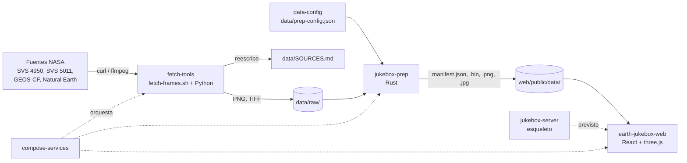
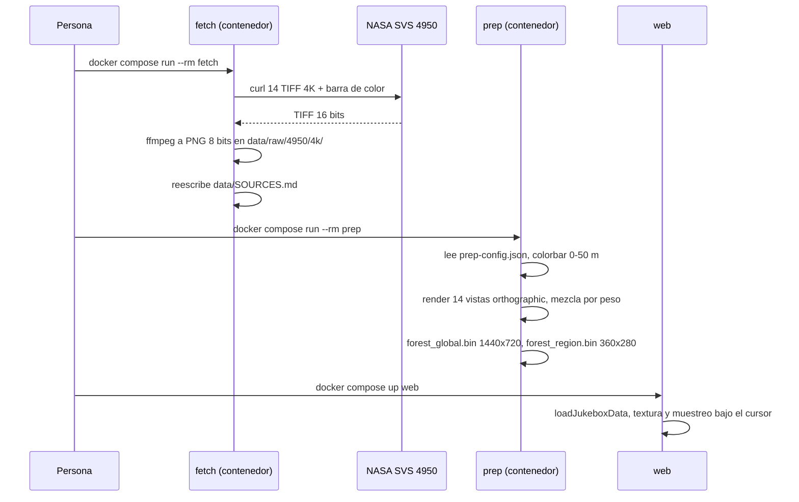
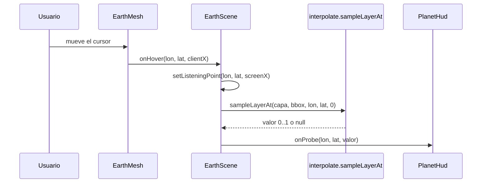

# Arquitectura — Earth Jukebox

## Architecture Analysis

### System Overview

Sistema local de tres etapas desacopladas por archivos: **descarga** (`tools/fetch-frames.sh` en el contenedor `fetch`) → **preparación** (`jukebox-prep`, Rust, contenedor `prep`) → **presentación** (SPA React + three.js servida por Vite; servidor Axum previsto). No hay base de datos ni API HTTP propia. El contrato entre etapas son archivos: `data/raw/*` y `data/prep-config.json` entre descarga y preparación; `web/public/data/manifest.json` + `<id>_<global|region>.bin` entre preparación y web.

### Architectural Style

Pipeline de datos por lotes + cliente estático (monolito de frontend). Evidencia: los servicios `fetch` y `prep` son trabajos de una sola ejecución tras perfiles de Compose (`docker-compose.yml`); la web solo hace `fetch()` de archivos estáticos (`web/src/data/loadManifest.ts`); `server/` es un esqueleto.

### Component Relationships

Texto alternativo: las fuentes de la NASA llegan a `fetch-tools`, que escribe `data/raw/` y reescribe `data/SOURCES.md`. `jukebox-prep` lee `data/prep-config.json` y `data/raw/` y escribe `web/public/data/`. La web lee esa carpeta. `jukebox-server` servirá la web más adelante. `compose-services` orquesta los tres contenedores.

### Data Flow

1. `fetch-frames.sh` descarga cada fuente con `curl` (sin autenticación hoy), convierte NetCDF→PNG (`geoscf_to_png.py`), video→PNG acumulado (`lightning_composite.py`) y TIFF 16 bits→PNG 8 bits (ffmpeg).
2. `jukebox-prep --config data/prep-config.json` valida la configuración, prepara la imagen base (8k, 4k y recorte de la Amazonía) y, por capa e instante, renderiza la región y el mundo a 4× la resolución de la cuadrícula: para cada celda busca el píxel en cada vista (`Projection::locate`), convierte color→valor (`colorbar`, `brightness` o `warmth`), mezcla las vistas por peso al cuadrado, promedia a la cuadrícula (`reduce_to_grid`) y cuantiza a bytes.
3. La web carga el manifiesto y las cuadrículas, valida tamaños, dibuja la capa activa como `DataTexture` con una rampa de color por capa y muestrea el valor bajo el cursor con interpolación bilineal (región dentro del rectángulo, global fuera).

### Key Design Decisions

- **Formato de intercambio mínimo**: 1 byte por celda, fila norte primero, columna oeste primero, instante tras instante; el navegador no decodifica imágenes para los valores.
- **Configuración declarativa de capas**: añadir o cambiar una fuente es editar `prep-config.json` (vistas, proyección, método de valor), sin código, mientras la fuente encaje en `equirect`/`orthographic` y un método de color.
- **Un método de valor por capa y mezcla por "mejor vista"** (`pipeline.rs:136-186`): la vista que ve el punto más de frente decide si hay dato; las demás se mezclan por peso. Pensado para globos renderizados, no para combinar fuentes con prioridad.
- **Todo en Docker** (regla del proyecto): imágenes con versiones fijas, código montado en vivo, salidas de build dentro de la imagen.
- **Sin internet en tiempo de ejecución**: fuentes del sistema, datos en `web/public/data/`.

### Improvement Opportunities

- Soporte de prioridad/relleno entre fuentes en `prep` (necesario para GEDI L3 + SVS 4950 fuera de ±52°).
- Lectura de rásteres científicos (GeoTIFF flotante, EASE-Grid 2.0) en `fetch` con una librería adecuada, entregando a `prep` una imagen equirectangular.
- Separar en `pipeline.rs` el render de capas, la escritura y la imagen base; muestreo por área en lugar de vecino más cercano.
- Representar "sin dato" distinto de 0 en las cuadrículas.

## Interaction Diagrams

### Regenerar los datos (flujo actual del bosque)

Texto alternativo: la persona corre `fetch`, que baja 14 TIFF de SVS 4950 sin login, los pasa a PNG y reescribe `SOURCES.md`; luego corre `prep`, que lee la barra de color y las 14 vistas orthographic y escribe las cuadrículas del bosque; la web las carga y muestra.

### Leer el valor bajo el cursor

Texto alternativo: el movimiento del cursor llega a `EarthMesh`, que informa lon/lat a `EarthScene`; esta publica el punto de escucha, pide el valor a `sampleLayerAt` (región o global) y lo envía al HUD.
