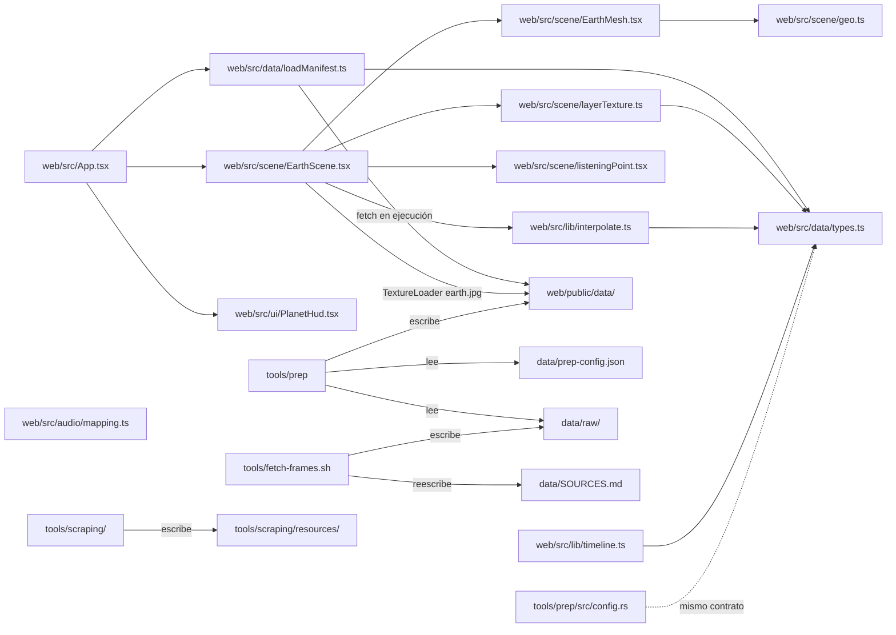

# Dependencies

Las versiones de cada paquete están en `technology-stack.md`; aquí se registran las relaciones.

## Dependencias internas

<!-- Texto alternativo: App.tsx importa loadManifest.ts, EarthScene.tsx y PlanetHud.tsx. loadManifest.ts importa types.ts. EarthScene usa EarthMesh, layerTexture, interpolate y listeningPoint; EarthMesh usa geo.ts. layerTexture, interpolate y timeline importan types.ts; mapping.ts no importa nada. loadManifest.ts descarga web/public/data/ y EarthScene pide earth.jpg de esa misma carpeta. tools/prep lee data/prep-config.json y data/raw/ y escribe web/public/data/. fetch-frames.sh escribe data/raw/ y reescribe data/SOURCES.md. tools/scraping/ escribe solo en su carpeta resources/ y no se conecta con prep. config.rs (Rust) y types.ts (TS) describen el mismo contrato sin compartir código. -->

Notas:

- `App.tsx` no importa todavía `timeline.ts` ni `mapping.ts`: la escena dibuja y muestrea solo el primer instante, y el sonido llega con el paso 10.
- `mapping.ts` es independiente; `interpolate.ts`, `timeline.ts` y `layerTexture.ts` solo importan tipos.
- El acoplamiento más fuerte es el contrato de datos entre `tools/prep/src/config.rs` y `web/src/data/types.ts` (incluido `LAYER_IDS`), sin código compartido ni generación. El id `co2` aparece además en `tools/prep/src/sample.rs`, `web/src/scene/layerTexture.ts`, `web/src/audio/mapping.ts` y `web/src/index.css`.
- `earth.jpg` es un acoplamiento por nombre de archivo: prep lo escribe con ese nombre fijo y la escena lo pide con `${baseUrl}earth.jpg`; el manifiesto no lo menciona.
- `tools/scraping/` no tiene ninguna dependencia hacia ni desde el resto del repositorio.
- `server/` no depende de ningún otro paquete del repositorio; servirá `web/dist/` y `web/public/data/` (copiados en la compilación).

## Dependencias externas

| Dependencia | Dónde | Tipo | Observación |
|---|---|---|---|
| Paquetes npm de `web/package.json` | Interfaz | Ejecución y desarrollo | Versiones fijadas; `package-lock.json` como referencia; instalados en el volumen `web_node_modules` |
| Crates de `tools/prep/Cargo.toml` y `server/Cargo.toml` | Rust | Ejecución | Requisitos semver (`0.25`, `1`, `0.8`, `0.6`) bloqueados por `Cargo.lock`; `--locked` en Docker |
| NASA SVS (`svs.gsfc.nasa.gov`) | `tools/fetch-frames.sh` | Datos en tiempo de preparación | SVS 4950, 5533, 5196 y 3615; nunca en tiempo de ejecución |
| Portal GEOS-FP (`portal.nccs.nasa.gov/datashare/gmao/geos-fp/`) | `tools/scraping/` | Datos de exploración | `das/` por día; el archivo completo son terabytes, los scripts usan límites |
| SVS search API, GISTEMP v4 CSV | `tools/scraping/collect_resources.py` | Metadatos de exploración | Opcionales (`--no-svs`, `--no-gistemp`) |
| `curl`, `ffmpeg` | Anfitrión | Herramienta | Solo para descargar cuadros |
| Nix + nixpkgs unstable | Anfitrión | Entorno | Solo para `tools/scraping/` |
| Imágenes Docker `node:20-bookworm-slim`, `rust:1-slim-bookworm` | Contenedores | Base | Deben construirse antes de la demo sin red |

## Dependencias pendientes o externas al árbol

- `web/src/audio/engine.ts` (paso 10) consumirá `mapping.ts` y el punto de escucha de `listeningPoint.tsx`.
- Las fuentes del intent `hires-data-layers` (Natural Earth 10 m, GEOS-CF v2 PM2.5, SVS 5011, cuadros 4K de SVS 4950) no aparecen todavía en ningún script ni configuración.
