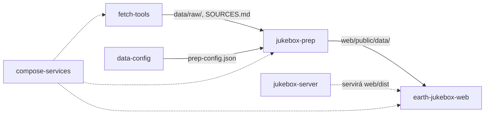

# Dependencias — Earth Jukebox

Versiones en `technology-stack.md`; componentes en `component-inventory.md`.

## Dependencias externas

- **Web** (`web/package.json`, `web/package-lock.json`): versiones exactas, instaladas con `npm ci` en la imagen; `node_modules` vive en el volumen `earth-jukebox_web_node_modules`.
- **prep** (`tools/prep/Cargo.toml` + `Cargo.lock`, `--locked`): `image`, `serde`, `serde_json`; dependencias precompiladas en la imagen.
- **server** (`server/Cargo.toml` + `Cargo.lock`): axum, tokio, tower-http.
- **fetch** (`tools/fetch/requirements.txt`): netCDF4, numpy, Pillow, pytest con versión fija; curl, ffmpeg, unzip por apt.
- **Fuentes de datos externas** (red, solo en `fetch`): `naciscdn.org` (Natural Earth), `portal.nccs.nasa.gov` (GEOS-CF), `svs.gsfc.nasa.gov` (SVS 5011, SVS 4950). Ninguna pide login hoy.

## Dependencias entre componentes

Texto alternativo: `fetch-tools` produce `data/raw/` para `jukebox-prep`; `data-config` le da la configuración; `jukebox-prep` produce `web/public/data/` para la web; `jukebox-server` servirá la web compilada; `compose-services` orquesta todo.

## Acoplamientos a vigilar

- `LAYER_IDS` duplicado en `tools/prep/src/config.rs` y `web/src/data/types.ts`.
- Formato del manifiesto en `config.rs` (Manifest/LayerOut/GridOut) y `types.ts`/`loadManifest.ts`; según `TAREAS.md`, no se cambia sin avisar a los tres.
- Nombres de archivo de `data/raw/` en `fetch-frames.sh` y `prep-config.json` deben coincidir.
- `data/SOURCES.md` lo genera `fetch-frames.sh`: editar el script, no el archivo.
