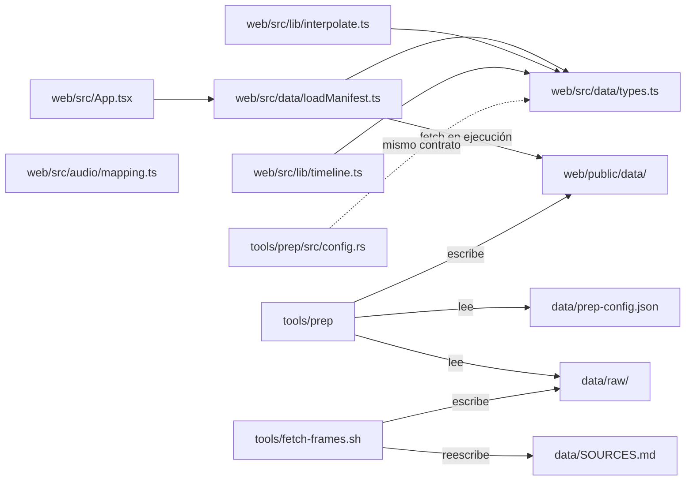

# Dependencies

Las versiones de cada paquete están en `technology-stack.md`; aquí se registran las relaciones.

## Dependencias internas

<!-- Texto alternativo: App.tsx importa loadManifest.ts, que importa types.ts; interpolate.ts y timeline.ts también importan types.ts; mapping.ts no importa nada. loadManifest.ts descarga web/public/data/ en ejecución. tools/prep lee data/prep-config.json y data/raw/ y escribe web/public/data/. fetch-frames.sh escribe data/raw/ y reescribe data/SOURCES.md. config.rs (Rust) y types.ts (TS) describen el mismo contrato sin compartir código. -->

Notas:

- `App.tsx` no importa todavía `interpolate.ts`, `timeline.ts` ni `mapping.ts`: la conexión llega con los pasos 10 y 12.
- `mapping.ts` es independiente; `interpolate.ts` y `timeline.ts` solo importan tipos.
- El acoplamiento más fuerte es el contrato de datos entre `tools/prep/src/config.rs` y `web/src/data/types.ts` (incluido `LAYER_IDS`), sin código compartido ni generación.
- `server/` no depende de ningún otro paquete del repositorio; servirá `web/dist/` y `web/public/data/` (copiados en la compilación).

## Dependencias externas

| Dependencia | Dónde | Tipo | Observación |
|---|---|---|---|
| Paquetes npm de `web/package.json` | Interfaz | Ejecución y desarrollo | Versiones fijadas; `package-lock.json` como referencia; instalados en el volumen `web_node_modules` |
| Crates de `tools/prep/Cargo.toml` y `server/Cargo.toml` | Rust | Ejecución | Requisitos semver (`0.25`, `1`, `0.8`, `0.6`) bloqueados por `Cargo.lock`; `--locked` en Docker |
| NASA SVS (`svs.gsfc.nasa.gov`) | `tools/fetch-frames.sh` | Datos en tiempo de preparación | SVS 4950, 5533, 5196 y 3615; nunca en tiempo de ejecución |
| `curl`, `ffmpeg` | Anfitrión | Herramienta | Solo para descargar cuadros |
| Imágenes Docker `node:20-bookworm-slim`, `rust:1-slim-bookworm` | Contenedores | Base | Deben construirse antes de la demo sin red |

## Dependencias pendientes o externas al árbol

- `web/src/audio/engine.ts` (paso 10) consumirá `mapping.ts`.
- La escena 3D (paso 12) consumirá `loadJukeboxData`, `sampleLayerAt`, `framePosition` y usará three, @react-three/fiber y gsap.
- Los scripts GEOS-FP para una capa de aerosoles están en la rama `origin/datos-rust` (`tools/scraping/`), no integrados en `main`.
